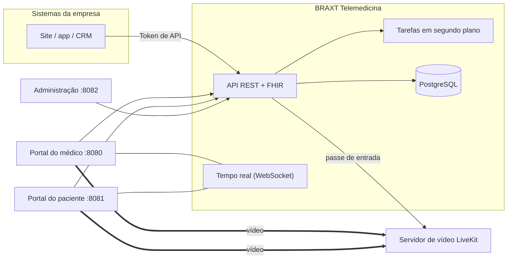
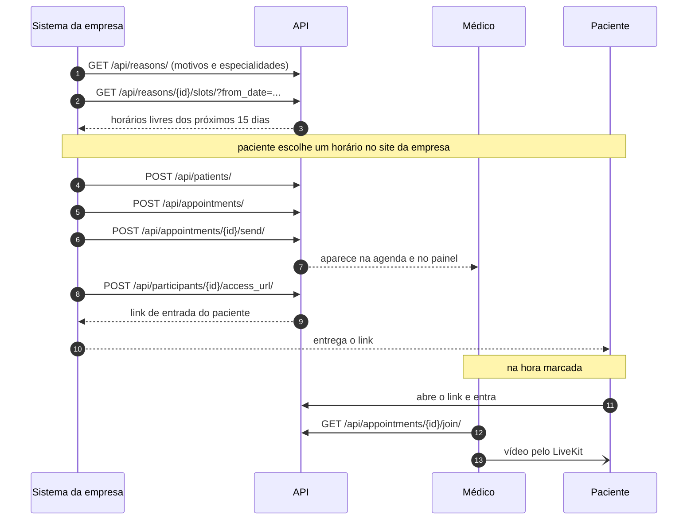
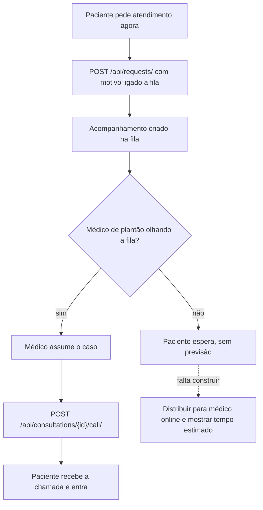

# Acesso ao sistema e mapa de funcionamento

Primeira parte: como subir a plataforma e entrar como médico, paciente e
administrador. Segunda parte: o fluxo em que os sistemas da empresa usam a API
para ler a agenda, achar horários livres e colocar o paciente na consulta sem
espera, com o que já existe e o que falta construir.

> **Antes de começar.** As contas de demonstração (`seed_demo`), a marca BRAXT
> e a tradução para português estão nos pull requests #1, #2 e #3. Faça o merge
> deles no `master` antes de subir, senão o sistema abre com a marca e os textos
> originais e o comando `seed_demo` não existe.

## 1. Subir o sistema

1. Baixar o código:

   ```bash
   git clone https://github.com/braxT9x/telemedicina.git
   cd telemedicina
   ```

2. Subir com Docker, gerando as imagens a partir deste código:

   ```bash
   docker compose up -d --build
   ```

   O `--build` é obrigatório. Sem ele o Docker baixa as imagens prontas do
   projeto original (iabsis), que não têm as nossas mudanças.

   Na subida, o serviço `provision` cria o ambiente (tenant `default`, domínio
   `localhost`), o superusuário `admin@example.com` com senha `admin` e o
   servidor de vídeo LiveKit local.

3. Conferir: `docker compose ps`. Todos devem estar `healthy`; `migrate` e
   `provision` rodam uma vez e terminam.

4. Carregar os dados de demonstração:

   ```bash
   docker compose exec api python manage.py seed_demo --schema default
   ```

   Rode de novo no dia da apresentação, até 1 hora antes: as datas são
   calculadas na hora do comando. O roteiro completo está em
   [ROTEIRO_DEMO.md](ROTEIRO_DEMO.md).

5. Abrir em dois navegadores (ou uma janela normal e uma anônima), um para o
   médico e outro para o paciente, e liberar câmera e microfone.

## 2. Endereços

| O quê | Endereço |
|-------|----------|
| Portal do médico | http://localhost:8080 |
| Portal do paciente | http://localhost:8081 |
| Administração | http://localhost:8082/admin/ |
| Documentação da API (Swagger) | http://localhost:8080/api/docs/ |
| Contrato OpenAPI | http://localhost:8080/api/schema/ |

Use `localhost`, não `127.0.0.1`: o sistema identifica o ambiente pelo nome do
endereço, e o cadastrado é `localhost`. Para abrir de outro aparelho é preciso
um domínio com HTTPS (o navegador só libera câmera e microfone em HTTPS ou em
`localhost`), ajustando `TENANT_PRIMARY_DOMAIN`, `PRACTITIONER_BASE_URL`,
`PATIENT_BASE_URL` e `LIVEKIT_URL` num `.env`.

## 3. Contas

Senha de todas as contas de demonstração: `Demo@2026`.

| Papel | Onde entrar | Nome | E-mail |
|-------|-------------|------|--------|
| Administrador | :8082/admin/ e :8080 | Administrador Demonstração | `admin@demo.example.com` |
| Médica de família | :8080 | Dra. Ana Souza | `dra.ana.souza@demo.example.com` |
| Cardiologista | :8080 | Dr. Ricardo Almeida | `dr.ricardo.almeida@demo.example.com` |
| Dermatologista | :8080 | Dra. Juliana Costa | `dra.juliana.costa@demo.example.com` |
| Psiquiatra | :8080 | Dr. Marcos Nogueira | `dr.marcos.nogueira@demo.example.com` |
| Paciente | :8081 | Maria Aparecida da Silva | `maria.silva@demo.example.com` |
| Paciente | :8081 | João Pedro Santos | `joao.santos@demo.example.com` |
| Paciente | :8081 | Rafael Gomes | `rafael.gomes@demo.example.com` |
| Superusuário técnico | :8082/admin/ | criado na instalação | `admin@example.com` (senha `admin`) |

Os demais pacientes estão no roteiro. Troque a senha do superusuário técnico
antes de qualquer uso fora da demonstração.

## 4. Como as peças se conectam



## 5. Fluxo desejado: agenda e horários pela API

A sala abre 10 minutos antes do horário (`appointment_early_join_minutes`).



Esse fluxo já funciona com um token de API de um usuário médico ou
administrador (admin, menu Tokens; header `Authorization: Token <valor>`).

## 6. Consulta sem espera



A presença em tempo real dos médicos já existe (`is_online`), mas não é usada
para distribuir pedidos.

## 7. O que a API já oferece

| Necessidade | Endpoint | Situação | Observação |
|-------------|----------|----------|------------|
| Acesso de sistema externo | `Authorization: Token …` | Parcial | Token preso a um usuário médico/admin, com acesso amplo. JWT em `/api/auth/login/`. |
| Especialidades, clínicas, motivos | `/api/specialities/`, `/api/organisations/`, `/api/reasons/` | Pronto | Podem ser públicos com `public_organisations`. |
| Horários disponíveis | `GET /api/reasons/{id}/slots/` | Pronto | `from_date`, `user_id`, `organisation_id`, `timezone`; 15 dias, desconta consultas e intervalo. Swagger diz 7 dias (desatualizado). |
| Grade do médico | `/api/user/bookingslots/` | Pronto | Cada médico edita a própria. |
| Agenda de atendimentos | `GET /api/appointments/`, `/api/fhir/Appointment` | Pronto | Filtros e ordenação; FHIR R4. |
| Cadastrar paciente | `POST /api/patients/` | Pronto | Identificador externo via FHIR. |
| Marcar para o paciente | `POST /api/appointments/` + `/send/` | Parcial | Não confere se o horário ainda está livre. |
| Paciente marca sozinho | `POST /api/requests/` | Pronto | Paciente logado; confere a grade. Não serve para marcar em nome de outro. |
| Link de entrada do paciente | `POST /api/participants/{id}/access_url/` | Pronto | Para comunicação "manual"; validade configurável. |
| Entrar na chamada | `GET /api/appointments/{id}/join/` | Pronto | Passe do LiveKit. |
| Chamar o paciente agora | `POST /api/consultations/{id}/call/` | Pronto | Toca no portal do paciente em tempo real. |
| Médicos online agora | campo `is_online` | Parcial | Sem consulta "disponíveis agora por especialidade". |
| Avisar a empresa | nenhum | Falta | Não há webhooks. |

## 8. O que falta construir

Nada disto foi implementado ainda.

| Item | Por que importa | Tamanho |
|------|-----------------|---------|
| Atendimento imediato: recebe o pedido, escolhe médico online da especialidade, cria a consulta e devolve o link | É a promessa de "sem demora" | Médio |
| Marcar horário em uma chamada só, com checagem de horário livre | Hoje são 3 ou 4 chamadas e sem proteção contra choque de horário | Médio |
| Webhooks (marcada, cancelada, iniciada, encerrada) | Agenda da empresa em dia sem polling | Médio |
| Conta de integração com permissões restritas e limite de requisições | Token atual tem acesso amplo | Pequeno |
| Tempo estimado de espera e posição na fila | Transparência para o paciente | Pequeno |
| Domínio com HTTPS e `livekit/livekit.yaml` (citado no compose, ausente no repo) | Paciente em outro aparelho e uso real | Pequeno |
| Corrigir descrição do endpoint de horários (7 → 15 dias) | Evita confusão | Mínimo |

Para a reunião, o fluxo da seção 5 pode ser mostrado pelo Swagger: crie um
token no admin para a Dra. Ana, clique em Authorize com `Token <valor>`, chame
`/api/reasons/` e depois `/api/reasons/{id}/slots/`.
